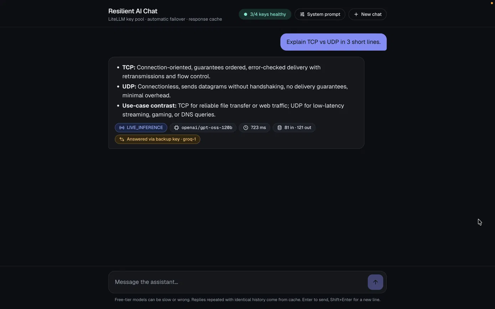
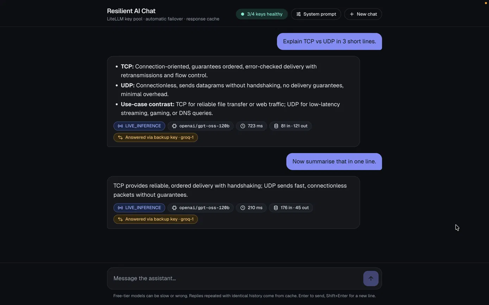
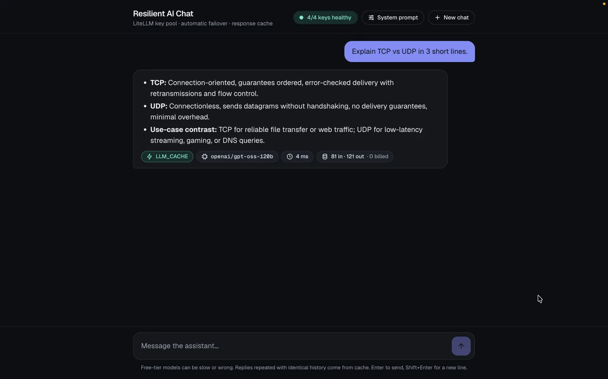
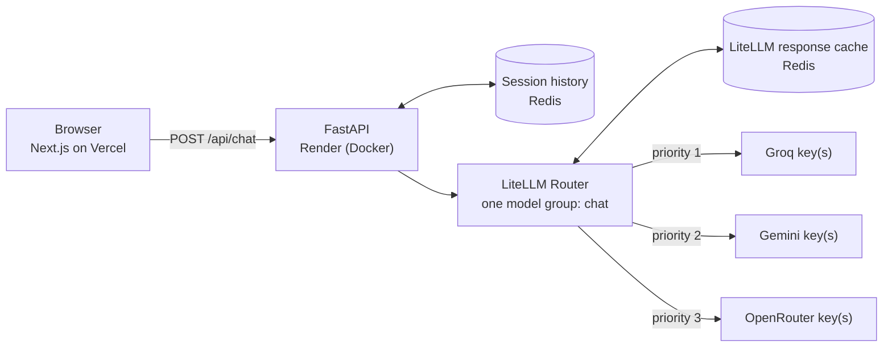

# Resilient AI Chat

A full-stack, multi-turn AI chatbot built on a **LiteLLM gateway** that keeps answering when an API key is rate-limited, over quota or failing, and reuses **LiteLLM's built-in response cache** to cut cost and latency. Every reply carries its own metadata: where it came from, which model answered, how long it took and what it cost in tokens.

## Screenshots

| 1. Live answer via backup key (failover) | 2. Multi-turn memory |
|---|---|
|  |  |

| 3. Same first message in a New chat → served from cache |
|---|
|  |

## How to see the cache

The cache key is a hash of the **full conversation** (system prompt + history + new message), not just the last message.

1. Send a fresh question → `LIVE_INFERENCE` (real model call, tokens billed).
2. Click **New chat** and send the *exact same first message* → `LLM_CACHE` (~5 ms, `0 billed`, original token counts shown).
3. Asking the same question again *inside the same chat* is live on purpose, because the history is different now.

Cached replies live in Redis (LiteLLM response cache) for 1 hour (`CACHE_TTL_SECONDS`). Chat history is stored separately per session (last 20 messages, 24 h).

> The word-by-word typing effect is a client-side reveal of the finished reply, not true token streaming.

| | |
|---|---|
| **Live app (frontend)** | [https://resilient-ai-chatbot.vercel.app](https://resilient-ai-chatbot.vercel.app) |
| **API base URL (backend)** | [https://resilient-chatbot-api.onrender.com](https://resilient-chatbot-api.onrender.com)  ·  [`/docs`](https://resilient-chatbot-api.onrender.com/docs)  ·  [`/api/health`](https://resilient-chatbot-api.onrender.com/api/health) |
| **Stack** | Next.js 16 (App Router, TypeScript, Tailwind) · FastAPI · LiteLLM Router · Redis (Upstash) |
| **Hosting** | Vercel (frontend) · Render, Docker (backend) |

> The free backend host sleeps when idle. The UI wakes it on page load and shows "Waking backend…", so the first visit after a quiet period can take up to a minute.

---

## Requirement → where it is implemented

| Requirement from the brief | Implementation | Verified by |
|---|---|---|
| Multi-turn chat UI | [`frontend/components/Chat.tsx`](frontend/components/Chat.tsx); history restored on reload | Browser run-through, `test_multi_turn_memory_and_per_request_tokens` |
| **Resolution source** `LLM_CACHE` / `LIVE_INFERENCE` | `metadata.source`, chip under every reply | `test_cache_hit_reported_through_api` |
| **Model used** | `metadata.model` (the model that actually answered) | `test_response_shape_and_metadata` |
| **Latency (ms)** | `metadata.latency_ms`, measured around the gateway call | same |
| **Token usage per request** (input / output) | `metadata.input_tokens`, `output_tokens`, taken from that request's own `usage` | `test_multi_turn_memory_and_per_request_tokens` (counts differ per turn, never a running total) |
| Optional system prompt | Panel in the header; stored per session, sent with every turn | `test_system_prompt_is_applied_and_persists` |
| Multi-turn state | Session history in Redis (TTL), in-memory fallback; last 20 messages sent to the model | `test_multi_turn_memory_and_per_request_tokens`, restart test (below) |
| **Key pool across models/providers** | One LiteLLM `Router` model group, one deployment per key, Groq → Gemini → OpenRouter by priority | `test_failover_walks_past_429_quota_and_5xx` |
| **Auto-fallback on 429 / quota / 5xx** | Router retries across the pool; failing keys enter a cooldown and are skipped | `test_failover_*`, `test_bad_key_enters_cooldown_and_is_skipped`, `test_auth_error_also_fails_over` |
| **No broken error screen** | All-keys-down returns a friendly `503` JSON message; the UI renders it as a chat bubble with **Try again**; a global handler hides stack traces | `test_all_providers_down_gives_friendly_503`, browser outage test |
| **LiteLLM built-in response caching** | `litellm.Cache` (Redis, or memory when no Redis) enabled through `Router(cache_responses=True)` | `test_repeat_request_is_served_from_cache`, `test_cache_is_shared_across_keys` |
| Deployed frontend + backend, connected | Vercel + Render web service, CORS locked to the frontend origin | live URLs above |

---

## Architecture



**One chat turn**

1. The browser sends `{session_id, message, system_prompt}`.
2. The API loads the session history, builds `[system?] + history + message` and calls the Router.
3. **Cache check.** If an identical request was answered recently, LiteLLM returns it with `cache_hit=True` and no provider is called → `LLM_CACHE`.
4. **Otherwise** the Router calls the highest-priority healthy key. On 429, quota, 5xx, timeout or auth failure it moves to the next key. A failing key is put in a cooldown and skipped for later requests, then retried automatically → `LIVE_INFERENCE` (+ `fallback_used` when a backup key answered).
5. The API saves the turn (with its metadata) and returns the reply plus metadata for that one request.
6. If **every** key fails, the user gets a friendly message and the failed turn is *not* added to history.

### API

| Method | Path | Purpose |
|---|---|---|
| `POST` | `/api/chat` | `{session_id, message, system_prompt?}` → `{session_id, reply, metadata}` |
| `GET` | `/api/health` | Pool status (labels + cooldowns, never keys), cache/session backend, counters |
| `GET` | `/api/session/{id}` | Stored history incl. per-message metadata (used to restore a chat on reload) |
| `DELETE` | `/api/session/{id}` | Reset a conversation |

```jsonc
// POST /api/chat → 200
{
  "session_id": "s_9f2c…",
  "reply": "…",
  "metadata": {
    "source": "LIVE_INFERENCE",        // or "LLM_CACHE"
    "model": "openai/gpt-oss-120b",
    "latency_ms": 412,
    "input_tokens": 38,                // this request only
    "output_tokens": 121,              // this request only
    "billed": true,                    // false on a cache hit
    "fallback_used": true,             // a backup key answered
    "served_by": "groq-1",             // non-secret label; null on a cache hit
    "retries": 1
  }
}
// all keys down → 503 {"error": {"code": "ALL_PROVIDERS_UNAVAILABLE", "message": "All AI providers are busy right now. Please try again in a minute."}}
```

---

## Design decisions and trade-offs

**All keys live under one LiteLLM model name.** LiteLLM builds the cache key from the model *group*, not the individual deployment, so a request hits the same cache entry no matter which key would have answered it (`test_cache_is_shared_across_keys`). Priority is set with `order`, so the cheap/fast provider is preferred and the others are true backups.

**What counts as a "repeated request".** The cache key is a hash of the *entire* message list (system prompt + history + new message). The same question asked again in the same chat has a longer history, so it is correctly a new request. A cache hit happens when the identical conversation is sent again, for example the same opening question in a **New chat**. That is the demo path below. Matching only on the last message would return answers that ignore context, which is worse than a miss.

**Tokens on a cache hit.** LiteLLM returns the original generation's counts. The UI shows them with **"0 billed"**, because the brief says "tokens consumed" and no new tokens were consumed. `metadata.billed` carries the machine-readable version.

**Providers, not just keys.** Gemini limits are per project and Groq limits are per organisation, so five keys on one account fail together. The pool spans three providers for redundancy that actually exists. (Creating extra accounts just to multiply a free quota can violate provider terms, so the pool does not rely on that.)

**Cooldowns instead of blind retries.** A key that just returned 429 is skipped for `COOLDOWN_SECONDS` (default 30), so one dead key costs one slow request, not one per message. `/api/health` and the status pill show it.

**Redis stays cheap.** Measured against a local Redis: ~4 commands per live turn, ~2 per cached turn, 0 when idle. The Upstash free tier (500K commands/month) covers well over 100K chats. Router cooldown state is kept in-process on purpose so it does not consume Redis commands.

**Graceful degradation.** No Redis configured → in-memory cache and sessions. Redis error mid-request → the request still succeeds from memory. Backend asleep → the UI polls `/api/health`, then retries the message automatically.

**Deliberately left out:** streaming. It complicates cache replay and per-request token accounting, and the brief does not ask for it.

**Safety limits.** Message length cap, history cap (20 messages), per-IP rate limit (30/min) so a reviewer's tab or a stray script cannot drain the free keys, CORS restricted to the deployed frontend, no keys in logs or API responses.

---

## Run it locally

```bash
# 1. Backend  (Python 3.13)
cd backend
python -m venv .venv && source .venv/bin/activate
pip install -r requirements.lock.txt          # fully pinned
cp .env.example .env                          # add at least one provider key
set -a && source .env && set +a
uvicorn app.server:app --reload --port 8000

# 2. Frontend  (Node 22)
cd ../frontend
cp .env.example .env.local                    # NEXT_PUBLIC_API_BASE_URL=http://localhost:8000
npm ci && npm run dev                         # http://localhost:3000
```

The test suite below needs no keys at all.

### Configuration (backend)

| Variable | Default | Meaning |
|---|---|---|
| `GEMINI_API_KEYS`, `GROQ_API_KEYS`, `OPENROUTER_API_KEYS` | – | Comma-separated keys per provider; priority is Groq, then Gemini, then OpenRouter |
| `GEMINI_MODEL`, `GROQ_MODEL`, `OPENROUTER_MODEL` | see `.env.example` | LiteLLM model strings (free-tier names change, so they are overridable without code changes) |
| `REDIS_URL` | – | `rediss://…` for cache **and** sessions; empty = in-memory |
| `ALLOWED_ORIGINS` | `*` | Comma-separated browser origins; set to the Vercel URL in production |
| `COOLDOWN_SECONDS` | 30 | How long a failing key is skipped |
| `CACHE_TTL_SECONDS` / `SESSION_TTL_SECONDS` | 3600 / 86400 | Expiry |
| `RATE_LIMIT_PER_MINUTE` | 30 | Per-IP limit on `/api/chat` |
| `DEMO_OUTAGE_KEY` | false | Adds a top-priority key that returns a real HTTP 429, to make failover visible |

---

## Testing

```bash
cd backend && pip install -r requirements-dev.txt && python -m pytest -q     # 18 tests, ~4 s, no API keys needed
```

The tests run the real LiteLLM Router against a local fake OpenAI-compatible provider whose behaviour is chosen by the API key (`bad429`, `badquota`, `bad500`, `bad503`, `bad401`, `good`), so every failure mode is deterministic. They cover: failover across 429 / quota / 500 / 503 / 401, cooldown skipping, cache hit vs miss (and no provider call on a hit), cache shared across different key pools, all-keys-down, per-request token counts, system prompts, session reset, validation, CORS, and that `/api/health` never contains a key.

Also exercised manually end to end: a real Redis (sessions **and** cache survive a server restart), the browser UI (including a phone-width layout), all providers down → friendly message → recovery via **Try again**, and the backend going away and coming back mid-request (the UI waits and delivers the reply automatically).

### Try it on the live site (60 seconds)

1. Open the app and ask anything. Read the badges under the reply: source, model, latency, input/output tokens.
2. Click **New chat** and send the **exact same first message** → the reply returns as **`LLM_CACHE`** in a few milliseconds, with **"0 billed"**.
3. Click the status pill to open **Key pool & resilience**. The `demo-outage-key` is deliberately failing (real HTTP 429), so replies show **"Answered via backup key"** and the pool lists it in *cooldown*.
4. Open **System prompt**, set "Answer in one sentence", **Apply**, and ask again to see it take effect (it also changes the cache key).

---

## Deployment

**Backend → Render (Docker, free).** New → Web Service → connect this repo, **Root Directory** `backend`, **Runtime** Docker, **Instance** Free. Add the variables from `.env.example` as environment variables (`*_API_KEYS`, `REDIS_URL`, `ALLOWED_ORIGINS`, `DEMO_OUTAGE_KEY`, …). Render injects `$PORT` and redeploys on every push to `main`; no card is needed on the free plan. [`render.yaml`](render.yaml) describes the same setup.

**Frontend → Vercel.** Import the repo, set **Root Directory** to `frontend`, add `NEXT_PUBLIC_API_BASE_URL` = the Render service URL.

Render's free web services spin down after 15 minutes without traffic and take roughly a minute to wake; an external uptime ping on `/api/health` every ~10 minutes keeps the service warm, and the UI shows a "waking up" state and retries if it is cold anyway.

## Security notes

- **No secrets in the repo.** Keys only come from environment variables; `.env*` is git-ignored; `/api/health` exposes labels such as `groq-1`, never keys.
- **Pinned dependencies.** LiteLLM is pinned (`requirements.txt`) and the Docker image installs a fully pinned lock (`requirements.lock.txt`). This matters: LiteLLM `1.82.7` and `1.82.8` were published to PyPI with a credential stealer on 24 March 2026. The pinned release (`1.100.0`, published September 2026) is well after that incident and is not one of the affected versions. Upgrade deliberately, never by version range.
- Errors returned to clients carry no provider text or stack traces.

## Limitations and next steps

- Free-tier models are rate-limited and sometimes slow; the pool exists precisely because of that.
- Cache hits require an identical conversation (see design decisions). A semantic cache (embedding similarity) would raise the hit rate at the cost of occasionally wrong reuse.
- Streaming responses, per-user auth, and a persisted usage dashboard are natural extensions.